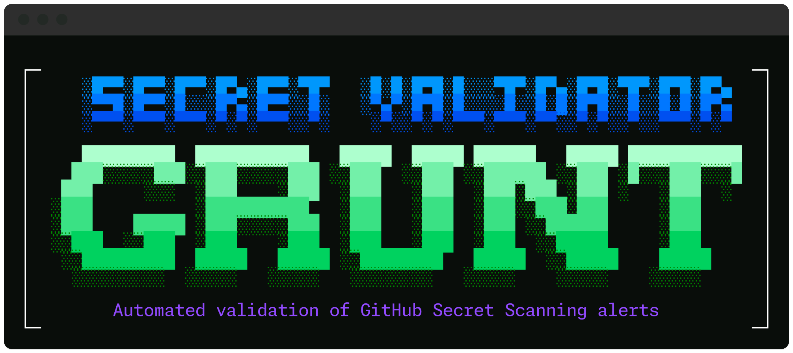

# secret-validator-grunt



Agentic framework for automated validation of GitHub Secret Scanning alerts using the [GitHub Copilot SDK](https://github.com/github/copilot-sdk).

## Overview

This app addresses the challenge of efficiently triaging and validating secret scanning alerts at scale. It orchestrates a three-stage pipeline — concurrent analysis sessions, adversarial challenge validation, and LLM-as-judge selection — to produce structured reports with confidence scoring.

### Key Features

- **Concurrent Analysis**: Run multiple validation agents in parallel, each with an independent workspace
- **Adversarial Challenge**: Each report's evidence and conclusions are independently challenged, with reruns kept separate from the original analysis evidence
- **LLM Judge**: Compares reports and selects a final analysis, informed by challenge results
- **Skills-Based Methodology**: Required guidance is supplied in workflow order; optional skills are loaded on demand
- **GitHub Integration**: Fetches alert details and locations via GitHub APIs, sharing results across agents to reduce duplicate requests

## Requirements

- Python 3.11+
- [uv](https://docs.astral.sh/uv/) and Git
- [Copilot CLI](https://github.com/github/copilot-cli) and access to Copilot
- [Copilot SDK](https://github.com/github/copilot-sdk) (installed during setup)
- GitHub token with permission to read the target repository and secret scanning alerts

## Setup

```bash
uv venv
uv sync --extra dev
cp .env.example .env  # configure your environment
```

See the [development guide](docs/development.md) for authentication and configuration. Values in `.env` override the defaults below.

## Usage

```bash
uv run secret-validator-grunt run org/repo alert_id
```

Options:
- `--analyses N` — Number of concurrent analyses (default: 3)
- `--show-usage` — Enable diagnostics display and persistence
- `--timeout N` — Per-analysis timeout in seconds (default: 1800)
- `--judge-timeout N` — Judge session timeout in seconds (default: 300)
- `--stream-verbose` — Show detailed streaming updates in the TUI

Reports by default are saved to `analysis/<org>/<repo>/<alert_id>/`.

**Live validation can affect production systems, including deleting data if an agent chooses a destructive endpoint.** Read [operational risks](docs/operational-risks.md) and obtain permission before testing real credentials.

## Pipeline

```
CLI -> pre_clone_repo -> N × analysis (concurrent) -> N × challenge (concurrent) -> judge -> final report
```

The repository is cloned once and copied into each analyst's workspace.

1. Each analysis agent independently researches the secret, writes verification scripts, and produces a structured report.
2. An adversarial challenger examines each report's evidence and reasoning. Original analysis evidence is made read-only, and reruns use a separate working copy.
3. A judge agent compares all reports with challenge annotations and selects the winner.

Review the evidence before acting on a verdict; agreement between agents does not guarantee correctness.

## Development

```bash
uv run --extra dev pytest tests/ -q  # run tests
uv run fmt                         # format code
```

Start with the [documentation guide](docs/README.md) for architecture, code structure, and development conventions.

## License

This project is licensed under the terms of the MIT open source license. Please refer to the [LICENSE](./LICENSE) file for the full terms.
